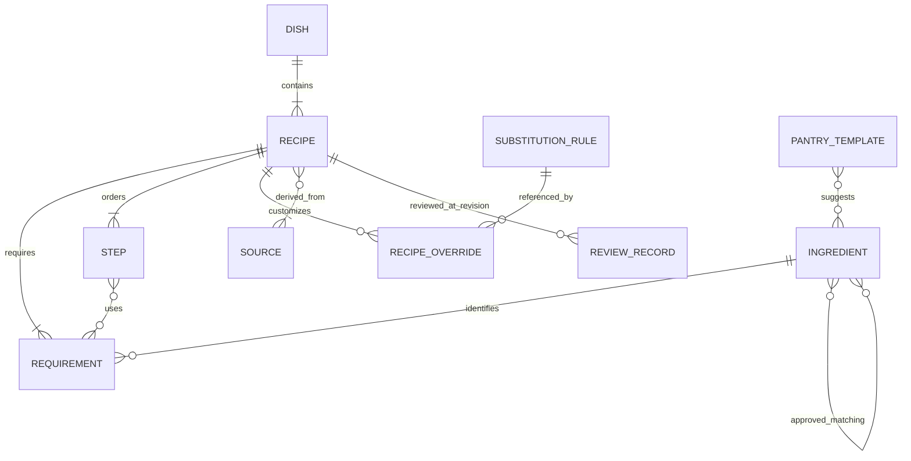

# 中餐食材匹配应用设计推进建议

本文承接《产品设计书v0.2》，围绕数据、匹配、交互、BYOK 和工程交付细化设计。首要建议是先把“已经具备必要条件”和“还需要确认条件”分清，再通过经过审核的菜谱和稳定的匹配规则缩短用户选菜时间。

本文中的新增方案均为设计建议。标为“已确定”的内容来自用户需求及设计书明确标记的约束；存在差异的地方列为待决策。配套 JSON Schema 是可校验的数据规范草案，示例菜谱是待审核的结构示例。

## 1 需求基线与决策边界

| 状态 | 内容 | 对设计的约束 |
|---|---|---|
| 已确定 | 以当天食材与持久化调料柜寻找中式家常菜 | 选材变化直接更新结果，调料无需重复输入 |
| 已确定 | 使用已有结构化菜谱，核心推荐确定且可解释 | 每项可制作性结论保留判定依据 |
| 已确定 | 核心功能离线，无需账号，用户数据留在设备 | 匹配与数据读取在本地完成 |
| 已确定 | Expo、React Native、TypeScript，Android APK 经 GitHub Releases 分发 | 采用独立于界面的 TypeScript 引擎 |
| 已确定 | Material Design 3、固定黄色品牌配色、支持浅深色 | 保留现有视觉方向，具体色值经可读性验证 |
| 已确定 | BYOK 自愿启用、用户主动调用、设备直连、请求可审查 | 联网模块具有明确的确认边界 |
| 已确定 | 菜品与具体做法分开，存储位置与烹饪角色分开 | Dish 对应多个 Recipe；葱姜蒜可放在任一用户清单 |
| 设计书建议 | 模板减法初始化、隐含油盐水、继承上次食材、200–300 道菜 | 保留为方案和目标，需通过输入准确率与建设成本评估 |
| 已确定 | 用户已确认保持确定性排序，AI 仅辅助离线数据整理 | 排序由可回归测试的规则完成 |
| 待决策 | “核验菜谱”的发布标准 | 推荐同时记录资料审核和实际试做；只有试做通过才展示“已试做” |

v0.2 第 16 节要求按阶段交付。本次交付设计及数据约束，工程任务仍按阶段单独验收。本文引用的外部资料查阅日期为 2026 年 10 月 14 日；服务能力、许可和依赖应在正式采用时按固定版本再次核对。

## 2 需要先解决的设计问题

| 位置 | 问题及影响 | 建议 |
|---|---|---|
| v0.2 第 7.3 节 | 必要原料“不确定”被归入“能做·有提示”，标题会夸大可制作性 | 增加“需确认”结果组；必要条件确认前不计入可做数量 |
| 第 4.5 节 | 普通分类层级可能把形态、部位、加工方式不同的原料当成可直接满足 | 分离分类树与烹饪匹配关系；后者逐条审核 |
| 第 6.3、7.3 节 | poor 级可显式允许，但原分层表仅排除了 acceptable，存在落入“能做”的空隙 | 所有已采用的非 equivalent 替代都产生风味提示 |
| 第 7.2 节 | 只按原始 ID 命中占用型原料召回，可能漏掉层级、替代、常备主料或全部为非占用原料的菜谱 | 先用完整扫描建立正确性基准；需要优化时再构建语义完整的倒排索引 |
| 第 7.5 节 | 直接统计“缺一项”的 Recipe，会重复计算同菜做法，也会计算仍需确认的菜 | 模拟补入原料后重新匹配，按新增可做的 Dish 计数 |
| 第 4.2、4.3 节 | 油盐同时出现在模板与隐含常备中；无条件常备无法表达用户明确缺少 | 模板去重，提供一处常备项说明及缺少例外；例外属于待确认交互调整 |
| 第 8.4 节 | 厨具总占用时长缺少步骤依赖与人的操作时间，无法推导可靠的最短完成时间 | 配餐先判断原料冲突；排程须补充步骤依赖、厨具容量和人工操作时段再评估 |

这些调整直接影响“真正能够制作”的判断，应在扩大数据集之前冻结语义。

## 3 数据库与 JSON Schema

### 3.1 实体关系

建议以版本管理中的 JSON 为编辑源，以构建生成的 SQLite 为运行数据。用户数据使用独立 SQLite 文件，菜谱更新时保留用户清单。

`ReviewRecord` 也可审查原料、替代规则和模板，使用 `subject_type + subject_id + subject_sha256` 指定对象，并用 `dependency_sha256` 绑定依赖内容。`hash_format` 固定为 `sha256_rfc8785`，采用规范化 JSON 后计算摘要。图中的多对多关系在 SQLite 中用连接表表达。

| 实体 | 关键内容 | 约束 |
|---|---|---|
| Ingredient | 稳定 ID、多语言名称、别名、分类父级、显式匹配父级、常备标记 | 分类关系不自动形成烹饪可替换关系 |
| Dish | 稳定菜品 ID、名称 | 多种做法聚合为一张推荐卡片 |
| Recipe | 菜品 ID、份数、总时长、菜类、辣度、厨具、需求、步骤、来源、审核状态 | 一个对象对应一种完整可执行的做法 |
| Requirement | 稳定需求 ID、原料、role、importance、consumes、数量、省略说明 | 相同原料在不同步骤的用量可分别记录；缺料按原料去重 |
| Step | 稳定步骤 ID、多语言文字、用料引用 | 省略和替代操作可以定位到具体步骤 |
| SubstitutionRule | 目标原料、替代原料、作用范围、等级、条件、用量处理、说明 | 有方向、单跳应用；必要条件全部满足才可使用 |
| RecipeOverride | 需求 ID、规则 ID、allow 或 forbid、步骤调整 | forbid 优先；修改步骤绑定具体做法 |
| PantryTemplate | 模板 ID、地区、名称、原料列表 | 不覆盖用户已确认的清单 |
| Source | provenance、revision、license，包含原文位置、版本、快照哈希及许可证据 | 正文与图片分别记录权利来源；获取时间和采用范围由导入清单保存 |
| ReviewRecord | 对象、内容哈希、审核方式、审核者、时间、结论 | 内容变更后重新审核受影响对象 |

本地用户表建议采用 `inventory_item(ingredient_id, location, updated_at)`、`user_settings` 和 `meal_basket_item`。清单中的物品只记录种类；`location` 为当次食材或调料柜，同一 ID 仅保留一份拥有状态，移动位置不增加库存。若接受常备项例外，再增加 `staple_override(ingredient_id, available)`。显式缺少覆盖隐含常备。更具体的原料与未细分父类同时出现时，界面提示合并或确认，避免把一个库存项目计成两样。

菜谱数据库建立 `requirement(ingredient_id, recipe_id)`、`recipe(dish_id)`、原料别名与匹配边索引；步骤及其用料连接表采用复合外键，确保引用属于同一 Recipe。每个数据库连接显式开启外键检查，构建后检查引用完整性。SQLite 的外键开关应由应用明确设置。[SQLite 外键说明](https://www.sqlite.org/foreignkeys.html)

### 3.2 配套规范与校验边界

[catalog.schema.json](../data/schemas/catalog.schema.json) 采用 JSON Schema Draft 2020-12，自包含实体定义，可分别使用其中的 `$defs` 校验单个实体，也可校验完整数据集。[minimal-catalog.example.json](design/minimal-catalog.example.json) 演示一个待审核做法的完整关联。阶段 1 的文件组织和校验方式见[数据标注规范](数据标注规范.md)。

Schema 限制字段类型、必填项、枚举、ID 格式、字符串及数组长度，拒绝未声明字段。数量使用互斥结构表达确定值、范围或适量。建议发布数据优先采用 `g`、`ml`、`piece`，其中 piece 可为分数。保留 `tbsp` 与 `tsp` 时强制声明 `spoon_standard=metric_15ml_5ml`，分别表示 15ml 和 5ml；其他单位禁止该字段。“半碗”在原始草稿中保留，审核者补充容积或重新测量后再归一化。“适量”只用于真实的经验用量，不用于掩盖解析失败。

| 校验层 | 检查内容 |
|---|---|
| Schema | 数量必须为正、requirements/steps/source_ids 非空、枚举合法、确定值与范围互斥、必要字段齐全；可选关系允许空数组 |
| 跨实体语义 | ID 唯一、引用存在、匹配图无环、范围下限不超过上限、步骤修改引用有效、重复规则与冲突检测 |
| 发布门禁 | 来源可发布、许可义务可履行、审核哈希对应实际内容、关联原料与规则审核通过、黄金场景通过 |
| 烹饪审核 | 用量合理、步骤可执行、必要性标注准确、替代后做法成立、耗时可信 |

JSON Schema 的 `format` 在不同验证器中可能只作注解。校验工具需要明确启用 `reviewed_at` 的日期格式校验；来源定位字段支持 URL 或受控路径，其合法性和路径安全由导入器校验。外键、图环和审核有效性仍需单独实现。[JSON Schema 验证规范](https://json-schema.org/draft/2020-12/json-schema-validation)

`license.state=verified` 在 Schema 中仅强制具备许可标识、证据位置与证据哈希。实际权利审核及上游快照哈希由发布门禁核对。即使根对象标为 `published`，通过结构校验仍不代表具备发布资格；门禁必须检验有效审核记录。

`schema_version` 表示结构协议，`dataset_version` 表示数据发行。一个菜谱的审核还依赖其引用的字典与规则版本。规则或匹配边发生变化时，构建工具计算受影响菜谱，要求重跑场景并重新确认相关审核；仅校验菜谱自身哈希不足以保障结果不变。

### 3.3 标准原料字典

以下为种子词条建议，供首批样本审核使用。是否等价由烹饪用途决定，搜索词相似不产生等价关系。

| 标准 ID | 展示名称与搜索词 | 归一化约束 |
|---|---|---|
| tomato | 番茄，西红柿 | 两个名称可自动指向同一词条 |
| egg | 鸡蛋 | “蛋”要求确认种类 |
| potato | 土豆，马铃薯 | 可自动归一 |
| green_pepper | 青椒 | 不把所有辣椒都映射为青椒 |
| pork | 猪肉，部位未细分 | 可作为泛指库存；不能确认里脊需求 |
| pork_tenderloin | 猪里脊 | “里脊肉”可能缺少动物种类信息，要求确认 |
| pork_belly | 五花肉 | 与里脊分别存储 |
| beef | 牛肉 | 不能通过“肉类”分类满足猪肉需求 |
| chicken_thigh | 鸡腿肉 | 与鸡胸肉分开 |
| firm_tofu | 老豆腐，北豆腐 | 地区别名经审核后加入 |
| soft_tofu | 嫩豆腐，南豆腐 | 内酯豆腐独立标注 |
| bok_choy | 小白菜 | “青菜”作为歧义搜索词处理 |
| cucumber | 黄瓜 | 与腌黄瓜分开 |
| fresh_shiitake | 鲜香菇 | 干香菇单独建词条，泡发属于做法条件 |
| dried_shiitake | 干香菇 | 与鲜香菇之间的用量不靠名称换算 |
| scallion / ginger / garlic | 葱、姜、蒜 | 存储位置由用户选择，菜谱角色逐条标注 |
| light_soy_sauce / dark_soy_sauce | 生抽、老抽 | “酱油”不自动归一为任意一种 |
| rice_vinegar / aromatic_vinegar | 米醋、香醋 | “醋”不确认具体品种，替代单独审核 |
| oyster_sauce / doubanjiang | 蚝油、豆瓣酱 | 不能按“酱料”类别互相满足 |
| corn_starch | 玉米淀粉 | “生粉”可能歧义，结合用户选择确认 |
| sugar / salt / cooking_oil / water | 白糖、盐、食用油、水 | 特定油脂需求单独建词条 |

分类树用于浏览。`matching_parent_ids` 表示经过审核的“这个具体原料可以满足该泛指要求”。只有允许任意该部位集合的做法才引用泛指节点；糖醋里脊需要具体里脊时，需求直接写 `pork_tenderloin`。匹配边限制为语义收窄到泛指的关系，禁止把替代关系放入此图。

别名索引保存一个搜索词的全部候选及是否需确认。拼音和首字母只用于检索，用户选中标准词条后才写入 ID。发布时检查歧义词不会被单一自动映射抢先吞掉。构建期生成拼音索引，可减少移动端依赖。

### 3.4 必要性与替代标注

`required` 表示缺少后无法按该做法完成或无法保持菜品身份；`important` 表示允许省略但会产生明确的风味变化；`optional` 表示可以省略且影响轻微。每个可省略项目都要写明影响，并确保步骤能够同步省略相应动作。

例如番茄炒蛋中的鸡蛋通常应为 required，点缀葱花可为 optional。蚝油是否 important 取决于具体配方；依赖蚝油作为主要调味来源的做法可能需要 required。麻婆豆腐不同做法对酱料有不同约定，标注应与具体做法的来源及试做结果绑定。

`role` 只控制展示。`consumes` 表示在按种类管理库存时是否保守地占用该物品。蒜蓉菜中的大量蒜可以是 seasoning 且 consumes=true；点缀用葱花可以是 garnish 且 consumes=false。二者均需结合做法判断。

替代规则建议按以下顺序处理。

1. 按需求和具体做法收集候选规则，先执行 forbid。同一原料对的重复规则需要合并或明确区分条件，避免换一个 rule_id 绕过禁用。
2. 核验替代品确实存在、烹饪方法和其他条件已满足。条件未知时保留“需确认”。
3. 优先使用直接原料，再选择 equivalent、acceptable 和显式获准的 poor。同级按稳定规则 ID 决定。
4. 只允许单跳替代。A 可替 B、B 可替 C，不推出 A 可替 C。
5. 应用已审核的用量处理和步骤调整，生成与实际做法一致的详情。变更步骤的规则绑定到具体 Recipe。

全局规则适用于经过审核且条件完整的情况。米醋代香醋之类的关系应从菜谱级规则起步，完成适用方法和风味核验后再考虑推广。替代说明应具体到操作，例如“使用某替代品后，在指定步骤减少某一调味量”，不能仅给“可以替代”的结论。需要多种材料共同替代一种材料的配方，建议直接建为另一种做法，避免增加组合规则求解成本。

`scope=recipe` 必须带 `recipe_id`，并由所属做法中的 `requirement_id + rule_id` allow 覆盖激活；全局 poor 也需显式 allow。Schema 检查字段组合，引擎及语义校验器负责外键、规则激活、forbid 优先和单跳限制。

规则的 `requires_available_ingredient_ids` 只表示做法已有且实际采用的配料前提，不能借此隐式加入未列出用量和步骤的新配料。需要新增配料的替代另建做法。`quantity_ratio` 缺少或与原需求单位不适用时，必须有经过审核、可执行的 `usage_note` 并经用户确认；缺少处理依据时禁用该规则，不能仅凭 equivalent 等级判断可做。

## 4 数据集建设与权利记录

### 4.1 来源选择

| 来源 | 已核实的事实 | 采用建议 |
|---|---|---|
| HowToCook | 根 LICENSE 声明 Unlicense | 作为候选文字源，固定提交并逐篇审核；图片单独审查 |
| 自行编写与明确授权的贡献 | 权利范围取决于实际作者授权 | 用于补齐家常菜目标清单，投稿时记录正文和图片各自来源 |
| Wikidata | 主体结构化数据采用 CC0 | 辅助名称、别名和外部标识整理，烹饪匹配关系自行审核 |
| RecipeNLG | 官方下载条款限定非商业研究和教育用途 | 排除出公开 APK 的默认内置来源；需要另行取得适合本产品的授权 |
| Wikimedia Commons | 文件各有许可与署名要求 | 按单张图片筛选，保留署名及修改说明 |

相应依据为 [HowToCook LICENSE](https://github.com/Anduin2017/HowToCook/blob/master/LICENSE)、[Wikidata 许可](https://www.wikidata.org/wiki/Wikidata:Licensing)、[RecipeNLG 官方条款](https://recipenlg.cs.put.poznan.pl/dataset) 和 [Commons 复用说明](https://commons.wikimedia.org/wiki/Commons:Reusing_content_outside_Wikimedia)。RecipeNLG 条款本次通过官方页面的搜索索引取得，直接打开正文未返回；正式评估授权时须重新取得完整条款快照。

HowToCook 的仓库许可声明已核实，具体贡献的原创性和图片权利链仍需逐篇审查。可固定的一个提交为 `2b19c9e9ee926fd925a68207a57582a338813f9c`，对应的 [LICENSE](https://raw.githubusercontent.com/Anduin2017/HowToCook/2b19c9e9ee926fd925a68207a57582a338813f9c/LICENSE) 可读取；选定导入快照时还要确认目标菜谱文件及其历史。这里没有将该提交认定为最新版本。

上游存在明确的 [AI 处理提交](https://github.com/Anduin2017/HowToCook/commit/539a2b7a9aef4c6d1ec604eb38c98dd65b368ab0)，涉及菜谱简介和图片 alt 文本。这说明数据来源记录还应保留处理方式；具体步骤是否可执行仍由本项目审核。

建议代码使用 Apache-2.0、自有结构化数据使用 CC0，均保留为待决策选项。项目的数据许可只覆盖有权按该许可发布的内容，第三方素材保留原有义务；CC0 也不消除第三方相关权利。[CC0 说明](https://creativecommons.org/publicdomain/zero/1.0/deed.en) 贡献者采用 DCO 签署来源与提交权利声明，审核流程继续检查实际内容。[DCO 原文](https://developercertificate.org/)

### 4.2 清洗与审核流程

建议依次执行快照冻结、解析、归一化、标注、审核和发布。每次转换保留输入哈希、工具版本及差异记录，失败记录留在待处理队列。

解析器提取原料、用量、步骤及原文位置。“少许”“半碗”等表达保留原文，禁止自动推断成克数。AI 离线辅助时输出建议值与对应原文片段；无法从资料确认的值保持待审核。经过改写的内容仍需追溯原始来源。

人工审核包括关键原料身份、必要性、耗时、厨具、步骤与用料一致性。省略和替代必须与修改后的步骤一起审核。相似做法使用标题、标准原料集合及步骤相似度提示合并，最终由维护者决定 Dish 和 Recipe 的边界。

发布要求来源和许可证据完整、结构及语义校验通过、关键歧义清零、烹饪资料审核通过。审核方式分别记录资料复核与实际试做，界面标签遵循真实记录。图片尚未完成许可审查时，可以发布带完整文字的菜谱，保持图片作为独立资产处理。

### 4.3 建设顺序与成本

先编制维护者认可的 200 道目标清单。名称采用“目标家常菜清单”，在取得用户频率数据后再称为高频清单。覆盖率按唯一 Dish 计算；200 道清单达到 80% 意味着至少覆盖 160 道，其中每道均有一个满足发布门禁的做法。

首批 20 道建议覆盖不同匹配边界，选题可包括番茄炒蛋、青椒炒肉、土豆丝、醋溜白菜、手撕包菜、蒜蓉西兰花、香菇青菜、红烧茄子、家常豆腐、麻婆豆腐、黄瓜炒蛋、宫保鸡丁、可乐鸡翅、红烧肉、糖醋里脊、清蒸鱼、番茄蛋汤、紫菜蛋花汤、蛋炒饭和蒸蛋。选题只是审核工作清单，具体配方、用量与替代尚须逐道建立。

试点分别记录来源核验、解析修正、原料归一化、标注、审核和返工时间。扩充成本按各类菜谱的实测平均时间与退回率估计。例如仅作预算演示，若每道资料处理耗时 15–30 分钟，300 道对应 75–150 小时，另加字典建设、许可调查和试做；v0.2 的“数十小时”目前缺少计时依据。

调料柜模板按菜品去重统计 required 和 important 出现频率，并结合首次初始化测试选择条目。模板升级提供可选增量，不自动重置用户已确认的调料。

## 5 匹配与排序算法

### 5.1 输入与逐项判定

引擎输入由库存快照、筛选条件、固定版本数据集和本次规则确认记录组成。库存快照包括当次食材、调料柜、有效常备项及显式例外。规则确认绑定 recipe_id、rule_id、数据版本和有关库存项，相关内容改变后失效。未勾选项目视为没有声明拥有；已选择泛指原料但做法要求更具体原料时，产生不确定。

每条需求输出 `presence`、`match_kind`、`inventory_item_id`、`rule_id`、`reason_code` 及解释参数。`presence` 为 present、missing 或 uncertain；`match_kind` 进一步区分 exact、approved_descendant、implicit 和 substitution。解释由这些判定记录直接生成。

对一条需求先寻找确定的直接满足，再寻找经审核的具体到泛指满足，再评估全部适用的单跳替代。如果没有确定方案，但存在未确认部位或替代条件，返回 uncertain；否则返回 missing。存在泛指不确定项，同时又存在具体可用项时，以确定的项为依据。

对 optional 缺失默认采用省略方案，不主动使用会改变风味的替代来增加操作。important 缺失或不确定时采用已审核的省略方案并给提示。required 的不确定阻止进入任何“可做”组。

逐项候选还需组成整道菜的有效执行方案。收集所有省略与替代的步骤变更，相同变更去重，同一步的不同 replace 或 replace 与 skip 视为冲突。修改后步骤必须非空，配料引用和替代条件必须仍成立。单项最优组合失败时尝试其他已审核的组合，保留可行方案后再按稳定规则选优；全部失败时返回方案冲突，阻止进入可做组。为控制建设成本，建议发布做法避免让多条可选规则修改同一步，复杂组合拆成独立 Recipe。

### 5.2 候选检索与分层

200–300 个做法建议先扫描全部已发布做法。按厨具、耗时等明确条件筛选后，逐条评估需求。它提供容易审核的基准，也覆盖只使用调料柜主料或不含 consumes=true 的做法。匹配结果可按当次食材相关性排序；空选择时提供食材入口和确实由常备食材满足的菜谱。

定义 M 为不同 required 原料中明确缺失的数量，U 为尚未确认的 required 需求数量。重复用到同一种缺少的原料只增加一次 M。厨具明确不足时归入不可制作；厨具信息未知时记录需确认，不能用原料齐全覆盖该问题。

| 判定条件 | 结果组 | 用户可见含义 |
|---|---|---|
| M=0、U=0，important 全部满足，采用的替代均为 equivalent | 原料齐全 | 根据已确认种类可以按该做法制作 |
| M=0、U=0，存在 important 省略、important 不确定或采用 acceptable/poor | 可做，有风味提示 | 必要原料确定存在，详情列明影响与调整 |
| U>0，或厨具条件未知 | 需确认 | 如“确认猪肉是否为里脊”，同时显示已知缺料 |
| M>0、U=0，存在一种原料补入后可进入可做组 | 差一样 | 按补入模拟确认购买一种原料即可满足必要条件 |
| 必要原料不足且单项补入均不能解决，厨具明确不足，或方案冲突 | 条件不足 | 默认收起，明确展示仍缺少的条件 |

先排除厨具明确不足和方案冲突，再处理需确认，之后对仍缺必要原料的做法模拟单项补入，最后区分两个可做组。缺失目标原料数 M 不一定等于购买品种数，一种原料可能同时满足多个经审核的需求，故“差一样”使用第 5.4 节的重算结果。模拟只判断能否进入可做组，不递归生成购买提示。缺少 optional 不影响组别。用户未输入数量时，统一说明只确认原料种类；菜单中出现“可做”也遵循这一范围。

倒排索引可在性能需要时加入，必须覆盖直接 ID、匹配关系的两个检索方向和单跳替代，之后仍执行完整规则判断。索引结果与全量扫描的可展示结果应完全一致；具有零索引命中但可展示的做法单独保留，避免以“命中主料”作为绝对过滤条件。

### 5.3 稳定排序与解释

建议按结果组、缺少或不确定的 important 数量、required 不确定数量、替代影响、使用当次食材的种类数、耗时和稳定 ID 依次比较。替代影响按 poor 数量、acceptable 数量、equivalent 数量升序比较；实际使用的当次食材按库存 ID 去重后降序。排序使用固定字符串键，避免依赖设备语言导致同分顺序改变。

每个 Dish 先选出满足筛选条件且排序最好的 Recipe，再排序菜品列表。重复做法的统计始终以最终 Dish 为单位。

例如用户拥有青椒、未细分的猪肉和生抽，某做法要求青椒、里脊、生抽，蚝油可省略。该做法显示“需确认猪肉部位”，同时在详情显示省略蚝油的影响。用户确认库存是里脊后，再进入“可做，有风味提示”。解释、排序与实际使用的做法共同基于同一次评估，避免详情切换做法后仍显示旧结论。

### 5.4 再买一样

对库存加入一个候选原料，使用相同筛选条件完整重算。令 F(I) 为库存 I 下两个可做组包含的 Dish 集合，则新增数量为 `|F(I ∪ {x}) \ F(I)|`。已经有可做变体的菜品不重复计数，仍存在 required 不确定的菜品不计入。

购买候选来自缺少的必要原料及明确适用的替代品。需要具体部位时展示具体部位；需要泛指原料时表述为类别，不暗示任意该类别物品都适用。每条提示可展开查看新增的菜品。数量按实际重算结果显示，不能单纯累加“差一样”的记录。

### 5.5 配餐所需的正确性约束

菜篮冲突检查使用实际匹配到的库存物品 ID。两道菜分别要求猪肉和里脊，但都依赖同一份里脊时，仍构成冲突。不同替代选择可能形成不同库存分配，应在组合内重新分配可用原料，不能只比较菜谱的原始 ingredient_id。

“够用”只放行本次菜篮中特定库存项目的冲突，移除、替换菜谱后重新评估。人数放大配方仅调整参考用量，库存未录入数量时不声称份量充足。

每类选 15 个候选不能保证所有规模都只有数千种组合。两菜一汤与四菜一汤的搜索空间不同。建议采用固定候选上限及搜索预算，穷举适用于较小组合；更大规模采用保留前若干部分组合的搜索方式，并用小数据穷举对照检查质量。只有完成步骤依赖与资源排程评估后，才向用户展示预计总完成时间。

### 5.6 测试方法与评估口径

至少建立 50 条人工标注的库存场景，覆盖正常路径、边界及错误路径。每个场景固定数据版本，记录预期结果组、缺料集合、不确定集合和可采用规则。另留一批独立场景评估，避免修改算法时同时迎合测试标签。

| 测试范围 | 必须覆盖的行为 |
|---|---|
| 归一化 | 西红柿与番茄一致；“里脊肉”“生粉”保留歧义 |
| 层级 | 里脊满足已审核的泛指猪肉需求；反向需确认；牛肉不满足猪里脊 |
| 替代 | 单向生效、forbid 胜出、禁止传递、条件不满足或未知、poor 不会进入原料齐全组；无用量依据的规则被禁用 |
| 必要性 | required 缺失阻止可做；important 省略显示影响；optional 缺失不降级 |
| 聚合 | 同 Dish 多做法只显示一次；筛选后重新选择最佳做法 |
| 反向推荐 | 去除已有可做 Dish、去除仍需确认者、重复需求去重、一种新增原料同时满足多项需求、替代品补入后重算 |
| 用户状态 | 重复 ID 去重、常备例外、继承库存、扣减撤销、未知 ID 不静默丢弃 |
| 数据错误 | 悬空引用、循环层级、冲突规则、非法用量、无效步骤修改、失效审核被拒绝；拒绝新增隐含配料和省略后残留用料 |
| 整菜执行方案 | 同步省略与替代的步骤冲突、条件相互破坏被发现；存在其他有效组合时仍能找到可做方案 |

性质测试应验证输入顺序不改变结果、重复输入不增加食材覆盖分、增加确定拥有的原料不会使原有可做 Dish 变为不可做。若采用倒排索引，同一批场景的候选与全量基准对照；匹配与排序分别测试，避免排序掩盖可制作性错误。

Feasibility Precision@5 对“原料齐全”“可做，有风味提示”及两组合并后的列表分别计算，分母为各场景前五个实际显示结果数，另报告场景平均值与总体值。目标沿用 ≥95%，固定边界测试要求 required 不确定被误报到任一可做组的数量为零。为避免少显示结果抬高精度，同时报告结果数、有结果场景比例，以及前五项中真正可做的 Dish 数占人工真值 `min(5, 可做 Dish 数)` 的比例；建议该比例目标也为 ≥95%。人工真值无可做菜的场景单列误报率。缺料质量同时报告缺料集合完全一致率与漏报数，保留 ≥95% 的目标。上述目标均待真实样本评估，不能由 Schema 通过推导。

设 R 为做法数、K 为平均需求数、S 为每项检查的替代规则数。在层级闭包和库存查询已预计算、规则条件数量有上限时，逐项评估约为 O(RK(1+S))，排序约为 O(R log R)。整菜方案存在多个替代组合时还需计入组合搜索成本；构建期限制每道菜的组合总量，超过预算的做法先拆分或简化再发布，运行时完整检查允许的组合，避免截断搜索遗漏已存在的可行方案。反向推荐对 G 个候选原料重算时约增加 G 倍评估成本。所有性能判断以 release APK 真机结果为准。

## 6 移动端交互

建议把选材与推荐放在同一首页。顶部显示已选食材，可直接取消；增加食材时展开搜索与常用项面板。完成选择即收起面板并看到更新结果，保留“今天做什么、调料柜、设置”三个底部入口。

首次进入先展示精简调料模板，提供“这些都有”和逐项取消。用户不确认模板就不把勾选状态写成已拥有。常备油盐水在同页以一句说明呈现，是否允许明确标为缺少属于待决策。若允许，详情中的“我没有”会立即更新相应例外并重算。

老用户直接看到继承的食材与结果，顶部显示上次确认时间及“修改”入口。提示保持非阻塞；返回应用不强制重新确认所有食材。已经用完的调料在调料柜和菜谱详情均可就地修改。

结果卡片建议仅呈现菜名、时间、份数和最关键的一条判定信息。例如“番茄炒蛋”“15 分钟”“原料齐全”，或“青椒炒肉”“确认是否为里脊”。点击确认项弹出具体选择，避免让用户离开推荐流程。缺少主料、缺少必要调料、省略重要调料及采用替代分别用文字表达，不能统一写“缺料”。

详情显示实际采用的做法及已调整用料和步骤，允许查看原始做法、替代原因及来源。“做了这道”依据本次评估记录弹出实际使用的 consumes=true 库存物品，用户确认后再移除并提供撤销。使用替代品时移除真实替代品；处于调料柜的占用型物品也应在确认中注明位置。

Material 3 可通过 React Native Paper 主题实现；官方主题文档支持 MD3 和自定义颜色。[React Native Paper 主题](https://oss.callstack.com/react-native-paper/docs/guides/theming) 品牌黄色用于关键操作，状态用文本及图标表达。以 WCAG 对比度计算公式检查 v0.2 建议颜色，浅色黄底深色文字约为 9.48:1，深芥黄对白约为 6.48:1；两者满足普通文本 4.5:1 的目标。浅色 outline 对白底约为 1.50:1，深色 outline 对背景约为 2.01:1，若描边承担识别控件边界的作用，需要调整到至少 3:1。[文本对比度](https://www.w3.org/WAI/WCAG22/Understanding/contrast-minimum.html) [控件非文本对比度](https://www.w3.org/WAI/WCAG22/Understanding/non-text-contrast.html)

交互验收采用 8–12 位目标用户的形成性测试作为建议起点，覆盖新手与经常做饭者。记录首次模板完成时间、误勾选数量、打开到选定可做菜的时间、修正一个错误库存所需操作数。保留初始化 60 秒、老用户看到结果 15 秒的目标，同时增加从结果到选定做法的时间，避免只优化“显示结果”而忽略真正选菜。

## 7 BYOK 安全与供应商适配

### 7.1 数据流与密钥边界

建议流程为本地图像处理、生成请求、预览、确认、发送、校验结果、人工确认、写入标准食材。照片按实际像素重新编码并检查 EXIF 已清除，预览使用最终发送的图片。识别服务仅收到图片和识别所需指令，食材选择与调料柜不随请求发送。

Android 使用 SecureStore 保存用户密钥。其机制是以 Android Keystore 保护加密存储，应用调用时仍会取得密钥明文。密钥只在调用所需的短时间进入内存，排除日志、备份、错误上下文及导出内容；设备遭到控制时不能承诺密钥绝对不可读取。[Expo SecureStore](https://docs.expo.dev/versions/latest/sdk/securestore/)

配置保存为 provider、region、endpoint、model、随机 credential_ref 和能力声明，Key 放在独立安全存储中。供应商或区域变化时要求重新绑定 Key。删除 Key 后取消排队请求并阻止新调用；已发给供应商的内容不会因本地删除而撤回。

### 7.2 请求预览与真实发送保持一致

请求构建器只生成一次待发送对象，包含 URL、方法、公开请求头、模型、全部 Prompt、参数和最终图像。图片可用预览、字节数、MIME 与哈希表达；完整序列化请求可展开审查。Authorization 等凭据显示为遮蔽占位，发送时由 transport 注入。

用户确认绑定到该请求的序列化内容哈希。更换模型、图片、地址、参数或 Prompt 后，旧确认失效。发送模块使用已确认的对象，避免预览和发送分别拼接两份请求。费用估计只有在模型计费规则和输入规模可计算时显示，并注明估计依据；未知价格不显示为零。

所有供应商请求统一经过 transport。只接受 HTTPS，预置完整的服务商及区域端点，校验 URL 无凭据、无 Key 查询参数。建议先提供预置端点；任意自定义端点的支持保留为待决策。重定向必须在实际原生网络层阻断，不能仅假设 JavaScript fetch 参数生效。React Native 官方文档列出了 `redirect: manual` 的限制。[React Native 网络说明](https://reactnative.dev/docs/network)

本地确认次数限额在发送前事务扣减，发送状态不明时仍记一次尝试；该限额约束本应用的尝试次数，供应商侧预算才限制账户支出。超时、429、连接断开均不自动重试，用户再次确认后才发送。取消请求也不保证已被供应商接收的调用不会计费。

### 7.3 适配器职责

| 层 | 职责 | 可验证标准 |
|---|---|---|
| ProviderConfig | 供应商、地域、端点、模型及图像和输出限制 | Key 不会被发送到其他配置的主机 |
| RequestBuilder | 生成确定请求，声明结构化输出及图像支持方式 | 同一输入生成同一公开请求，预览与发送一致 |
| Transport | HTTPS、认证注入、重定向控制、超时、取消、响应大小限制 | 对 301、302、307、308 均不把 Key 或图像送到跳转目标 |
| ResponseParser | 处理 HTTP 状态、模型拒绝、截断和内容提取 | 非法 JSON、超长列表、未知字段、未知原料均有明确结果 |
| AuditLog | 保存调用时间、端点、模型、Prompt 版本或脱敏正文、请求哈希、状态及供应商返回的用量 | 默认不保存原图、base64、Key 或完整原始响应 |

识别输出建议限制为最多 30 个候选及受限长度的名称，可附供应商返回的置信度和粗略数量。模型自报置信度作为展示信息，不能解释成已校准概率；图片不能可靠证明重量和剩余份量。所有候选由用户确认后映射到本地字典，模型输出无法直接修改库存、发起网络请求或调用应用功能。

“兼容聊天协议”不意味着视觉输入、JSON Schema、用量统计、错误码和流式格式均兼容。每个供应商及模型组合须建立能力记录和请求响应样本。建议采用普通 HTTPS 请求与小型适配器，只有官方 SDK 明显降低维护成本且不会引入隐式联网时才引入。

| 首批候选 | 官方资料支持的能力与限制 | 设计建议 |
|---|---|---|
| 阿里云百炼 Qwen | 支持视觉图像与 Base64 输入；接口、API Key 与地域配置需要一致 | 作为面向中国大陆用户的首个评估候选，按模型单独验证图像和结构化输出 |
| Gemini Developer API | 支持内联图像，使用独立的请求结构；官方可用地区列表未列中国大陆 | 面向受支持地区评估独立适配器，端点和数据保留设置逐项核实 |

具体依据见 [百炼视觉理解](https://help.aliyun.com/zh/model-studio/vision)、[百炼兼容接口与地域](https://help.aliyun.com/zh/model-studio/compatibility-of-openai-with-dashscope)、[Gemini 图像理解](https://ai.google.dev/gemini-api/docs/image-understanding) 和 [Gemini 可用地区](https://ai.google.dev/gemini-api/docs/available-regions)。候选列表不代表已完成实际服务测试；具体型号、首发供应商及地域策略仍待决策。评估除准确率、延迟和实际费用外，还要比较拍照到确认的总时间是否短于手动选材。

### 7.4 验收范围

使用本地测试服务与 release 构建验证取消预览零请求、一次确认一次尝试、请求变更重新确认、脱敏日志、Key 删除后停止新调用、超大响应及图片拒绝、错误状态解析、重定向阻断。用于测试的假 Key 应搜索于日志、导出和备份，验证无泄露。

供应商真实视觉能力另用得到许可的食材图片做小批量手动测试，记录图片级候选准确率、漏识别率、修正操作数、耗时和实际费用。没有用户提供的 Key 时，协议契约测试与真实服务测试分开记录。

## 8 工程架构与交付任务

### 8.1 模块与数据发布

沿用 `/app`、`/packages/engine`、`/data`、`/tools`、`/docs` 的组织建议。引擎仅接收已经校验的普通对象并返回判定，不访问数据库、网络、系统时间或 React 状态。应用存储层构建库存快照，纯引擎评估后把统一结果交给列表和详情。

SQLite 菜谱包由构建工具生成，带 Schema 版本、数据版本和校验值。新 APK 首次启动时先导入并验证新菜谱库，再切换有效版本；用户库独立迁移。失败时保留可用旧库和用户清单，报告具体错误。删除或合并原料 ID 时提供显式映射，对无法迁移的用户条目保留可修正记录，避免静默丢失。

Expo SQLite 支持持久化数据库与随应用携带数据库资产，可据此完成本地数据方案。[Expo SQLite](https://docs.expo.dev/versions/latest/sdk/sqlite/) 发布版字体、图片、图标和数据均使用本地资产。对启用 `expo-updates` 的项目，建议显式配置 `updates.enabled=false`；默认的启动更新检查会影响零网络承诺，最终以 release 构建验证。[Expo 更新配置](https://docs.expo.dev/versions/latest/config/app/#updates)

“用户数据仅本地”还要覆盖 Android 系统备份。应用数据库、调用日志、临时图片与安全存储的备份规则分别检查，明确云备份和设备迁移排除策略；部分设备的设备间迁移不能仅依赖 `allowBackup=false`。用户主动导出时保留数据版本与完整性信息，排除 Key 和照片缓存。[Android Auto Backup](https://developer.android.com/identity/data/autobackup)

BYOK 如需自有原生 transport 来保证重定向控制，采用 Expo development build 与正式原生构建验证，不能以 Expo Go 中的行为作为验收依据。

应用依赖候选维持 Expo SQLite、React Native Paper 与一个国际化库，BYOK 对应 SecureStore 和必要的图像及网络原生能力。应用建项时按选定 Expo SDK 校验版本兼容并固定锁文件。数据工具的实际依赖由根目录 package.json 与锁文件记录。

### 8.2 分阶段工作与验收

| 工作包 | 交付物 | 依赖与验收 |
|---|---|---|
| 数据语义冻结 | 原料字典规则、Schema、标注约定、20 道资料完整的审核样本 | 确认不确定分层与发布标准；结构和跨引用检查通过，逐项标明审核方式 |
| 匹配引擎 | 纯 TypeScript 评估、分层、聚合、排序、反向推荐 | 至少 50 条黄金场景；必要条件不确定误报为齐全的固定用例为零 |
| 数据导入 | 固定上游快照、解析草稿、差异报告、目标清单及覆盖率 | 解析失败可追踪；已发布记录来源完整率 100%；扩充量由试标成本决定 |
| 离线移动端 | 选材、调料柜、列表、详情、扣减撤销、存储迁移 | 真机新老用户路径可完成；杀进程后状态保留；飞行模式全部核心功能正常 |
| 发布工程 | APK 构建、签名、权限清单、数据版本和 SHA-256 | 相同签名可覆盖安装；旧数据迁移测试通过；release 零隐式联网 |
| 菜篮配餐 | 库存分配、组合建议、冲突确认 | 冲突按真实库存 ID 检查；未放行冲突不进入组合；组合规模设预算 |
| BYOK | 供应商适配、预览、transport、安全存储、日志和人工确认 | 协议、安全测试通过；真实服务测试单列；识别结果经确认才进入库存 |

冷启动到结果保留 ≤1 秒作为目标。建议指定一台约定的中端 Android 真机，在 release 构建中进行 30 次冷启动，报告中位数与 P95，同时说明是否含数据库首次导入。新增的匹配耗时目标建议为 300 个做法下 P95≤50ms，选材到列表更新 P95≤150ms；这些数值是验收预算，尚无实测。

“零网络”验收覆盖冷启动、初始化、选材、详情、调料修改、后台恢复和空闲时段，检查 DNS 与连接尝试，不能只用断网可用证明无联网。基于应用 UID 或明确的测试环境排除系统其他进程流量。打开外部 GitHub 问题链接明确交给系统浏览器，并与应用自动请求分别记录。

GitHub Actions 构建采用固定工具版本与锁定依赖，发布权限最小化，签名密钥置于受保护环境，外部贡献的 PR 构建不读取发布密钥。公开工作流提供构建步骤透明性；相同输入是否得到逐字节相同 APK，需要单独进行可复现构建验证。

## 9 待确认决策

| 决策 | 推荐方案 | 评估依据 |
|---|---|---|
| 必要条件不确定的展示 | 独立“需确认”组 | 观察用户是否误以为能直接制作；黄金场景严格区分 |
| 隐含常备例外 | 油盐水默认拥有，允许用户显式标缺少 | 对比初始化时间、误报率及后续修正成本 |
| 核验发布标准 | 资料审核为基础，实际试做独立标记；关键替代要求试做证据 | 用户对“核验”的理解与可承担的审核工时 |
| 初次规模 | 先完成 20 道建设试点，再按成本扩充至目标清单 | 实测每道处理时间、退回率、缺口和使用覆盖 |
| 代码与数据许可 | 代码 Apache-2.0、自有数据 CC0 | 是否要求衍生版本开放、是否要求署名、上游权利兼容性 |
| 首批 BYOK 供应商 | 按中国大陆实际可用性筛选一家具备视觉能力的供应商，再验证第二套协议 | 地域、账号、图像支持、结构化输出和调用成本 |
| 任意自定义 BYOK 地址 | 先评估预置端点是否满足需求 | 防止 Key 误发、适配测试数量及维护成本 |

优先确认前三项即可冻结数据与单菜引擎的主要行为。许可在导入与发布前确定，供应商在 BYOK 开发前完成能力和地域核查。
